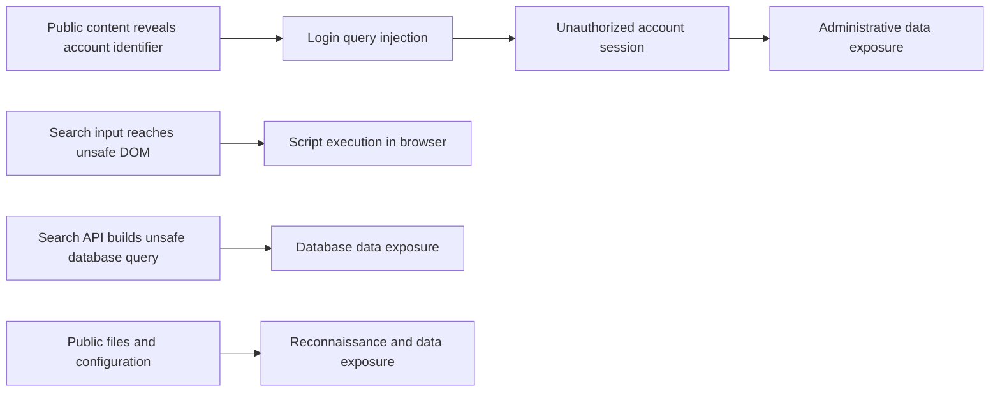

# Assessment overview

## Objective and environment

The assessment examined the deliberately vulnerable OWASP Juice Shop in a local Docker lab. Scope included anonymous browsing, route and API discovery, authentication, access control, input handling, file exposure, password storage, and token validation. The report describes a March 2026 snapshot; it is not a statement about current upstream versions or production deployments.

## Main observations

The findings connect into several paths rather than twelve unrelated defects:

These are relationships described in the assessment, not instructions for testing real services. Exposed identifiers can aid targeting, but are not credentials. Route names in frontend code are not authorization controls.

## Severity and reporting caveats

The detailed entries list twelve findings: six labeled Critical and six High. Elsewhere, the report's executive summary says nine findings (four Critical and five High), and a later roll-up repeats four and five. The totals do not reconcile. Labels in this guide are retained from the individual entries and were not independently rescored. Severity depends on deployment context; a route name in a public JavaScript bundle, for example, does not itself bypass authorization.

The critical label on publicly visible account information is context-dependent: identifier disclosure can aid targeting, but its impact depends on separate authentication weaknesses. Finding 7 is a chain of other flaws, not a distinct injection primitive. Treat these as the original report's judgments, not a verified scorecard.

## Reading and retesting

Each finding separates observed behavior, impact, safe local validation, and remediation. Use synthetic data in the isolated lab. After fixing an issue, repeat a minimal safe test and verify the expected behavior is enforced server-side. Check current OWASP guidance and the current Juice Shop version; challenge behavior may change.
