# Isolated lab setup

Juice Shop is intentionally vulnerable. Keep it on your own computer, bind it to loopback, and stop it when finished. Do not forward the port, bridge it to a shared network, or deploy this training container publicly.

## Run with Docker

Install Docker using its official instructions, then run the official image with a loopback-only port binding:

```powershell
docker pull bkimminich/juice-shop
docker run --rm --name juice-shop-lab -p 127.0.0.1:3000:3000 bkimminich/juice-shop
```

Open `http://127.0.0.1:3000` on the same computer. Binding to `127.0.0.1` prevents other hosts from reaching the mapped port. Do not change it to `0.0.0.0`, or expose it through a router, tunnel, or cloud host.

Stop the foreground container with `Ctrl+C`. If started detached, stop the named lab container:

```powershell
docker stop juice-shop-lab
```

The `--rm` option removes the container when it stops, not the image. Consult the [official Juice Shop documentation](https://github.com/juice-shop/juice-shop) for current setup options.

## Optional intercepting proxy

A proxy such as Burp Suite Community Edition can help inspect requests from your own browser. Configure a dedicated lab browser profile to use the proxy's local listener (often `127.0.0.1:8080`). Import a proxy CA only into that profile and remove it after the exercise. A trusted CA can inspect HTTPS traffic from that browser; do not install it system-wide or use the profile for unrelated browsing.

Confirm the browser uses the local Juice Shop address and proxy history contains only loopback traffic. Never replay requests against public hosts.

## Safety checklist

- The target is `127.0.0.1:3000`, not another party's hostname or IP.
- No port forwarding, public tunnel, or shared host is configured.
- Use synthetic lab accounts; never reuse real passwords or tokens.
- Do not save session cookies, authorization headers, or exported user records.
- Stop the container when finished.

## Report figures

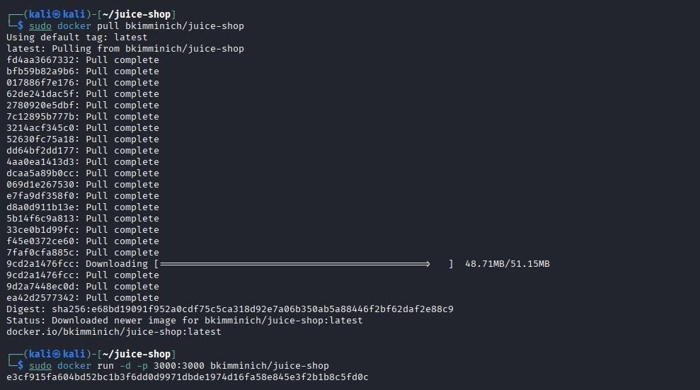

*Figure 1. Docker image pull and container startup.*

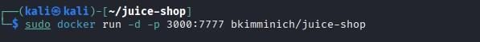

*Figure 2. Local Docker port mapping for Juice Shop.*

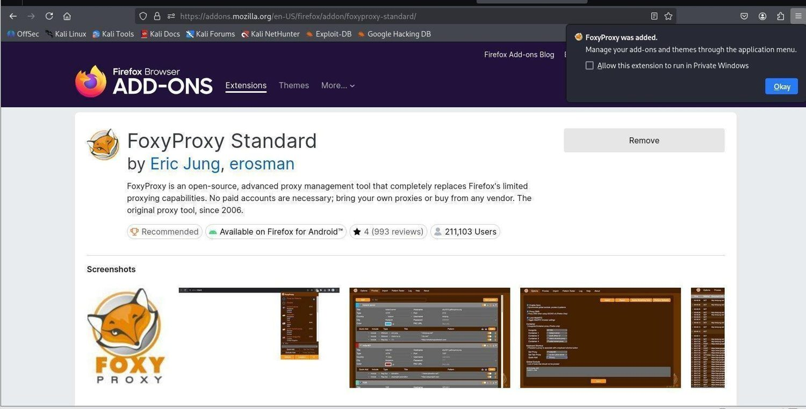

*Figure 3. Browser proxy extension installed for the lab.*

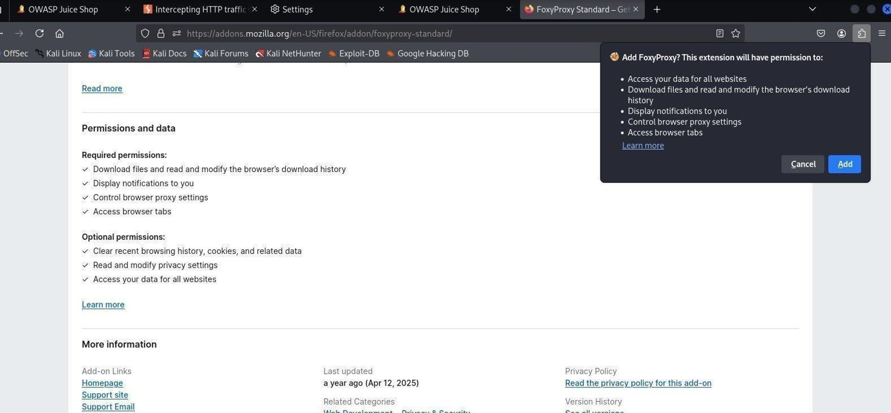

*Figure 4. Browser permission prompt during proxy setup.*

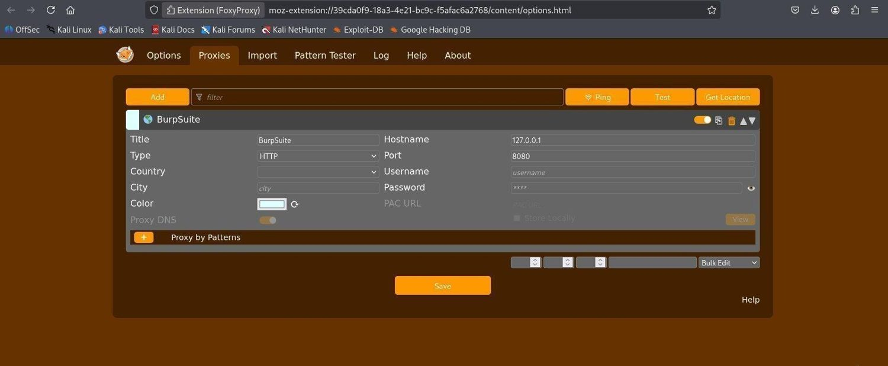

*Figure 5. Proxy configuration using a loopback listener.*

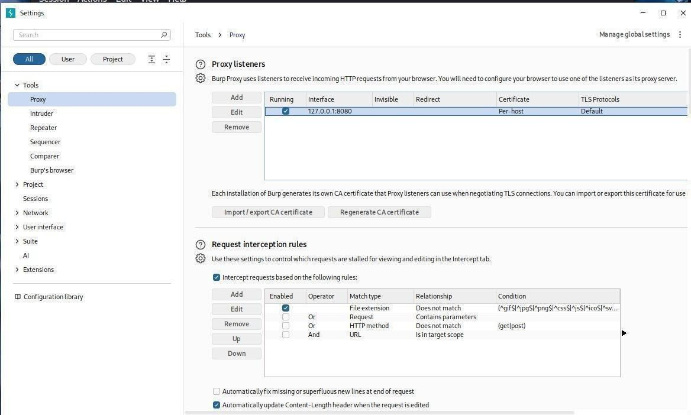

*Figure 6. Proxy selected for the lab browser.*

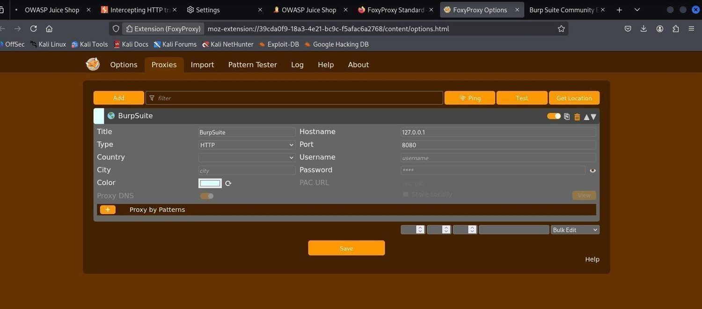

*Figure 7. Local intercepting proxy listener settings.*

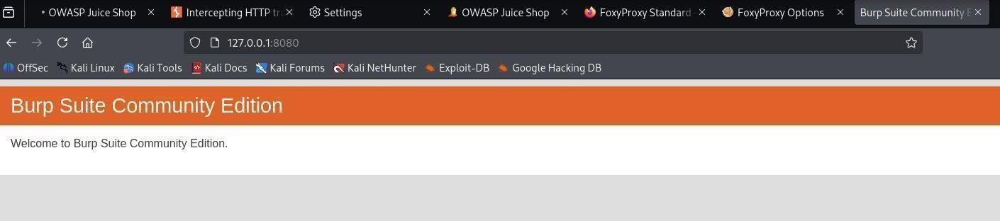

*Figure 8. Proxy welcome page on the local machine.*

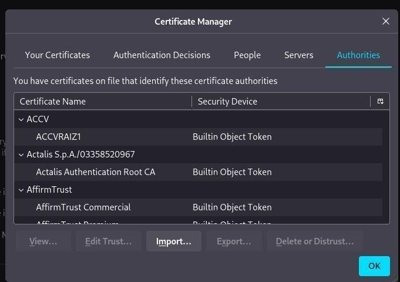

*Figure 9. Second check of the local proxy listener.*

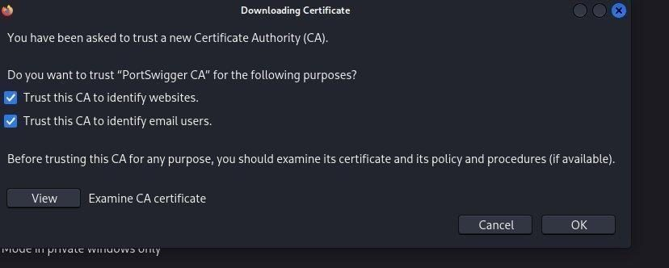

*Figure 10. Browser trust prompt for the proxy certificate.*

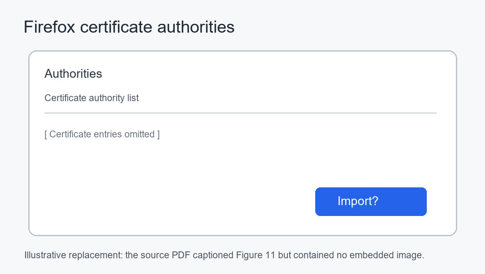

*Figure 11. Certificate manager import control; illustrative replacement because the PDF captioned this figure but had no embedded image.*

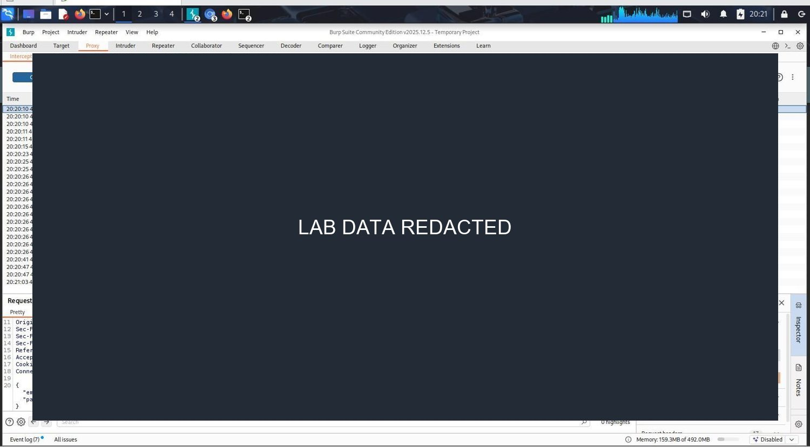

*Figure 12. Proxy history showing lab traffic; request details redacted.*
