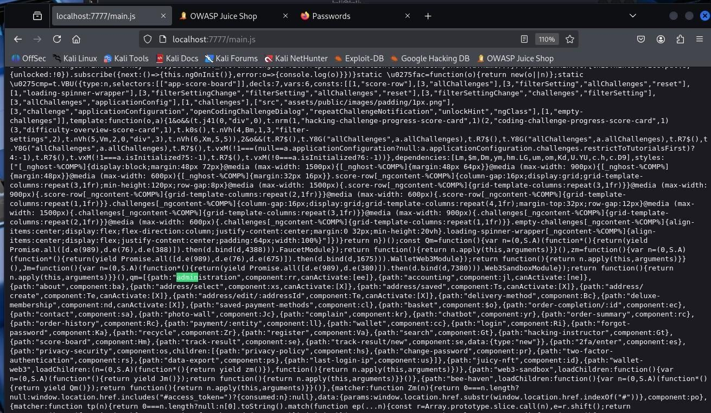
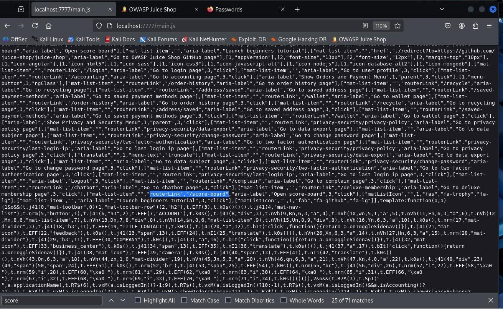
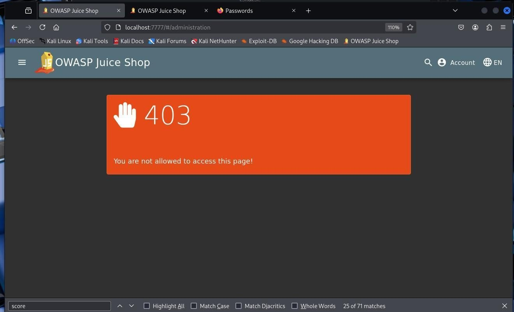
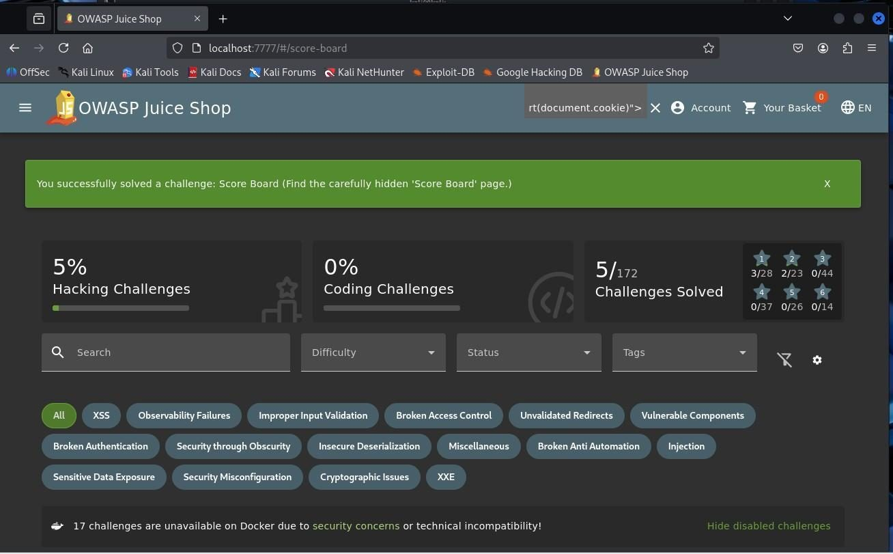

# Finding 2: Client-side route discovery

**Reported severity:** High (route disclosure alone is not an access-control defect)
**Theme:** CWE-200 Information Exposure

## Observation

The report found administration and score-board route names in the public single-page application JavaScript bundle. An anonymous request to the administrative view was denied, while the score board was intentionally discoverable as a Juice Shop challenge.

## Safe validation in the lab

Inspect JavaScript files served by your local instance and note whether route names are visible. Then request only the local administrative view without credentials and observe the result. A route being visible is not proof that authorization is missing.

## Impact

Client-side code is delivered to users and should be assumed inspectable. Route names can aid reconnaissance, but only a server-side authorization failure can expose protected data or actions. Minification and obfuscation are not security boundaries.

## Remediation

- Enforce authentication and role checks on every protected server endpoint.
- Use frontend guards for navigation only, never as the sole authorization control.
- Keep secrets and security decisions out of public bundles.
- Lazy loading can reduce initial bundle contents but does not replace server-side checks.

**Related:** [Administration access control](06-administration-access-control.md)

## Report figures

*Figure 14. Application JavaScript bundle route discovery.*

*Figure 15. Search within the JavaScript bundle for route names.*

*Figure 16. Unauthenticated request to the administrative route.*

*Figure 17. Juice Shop score board page.*
