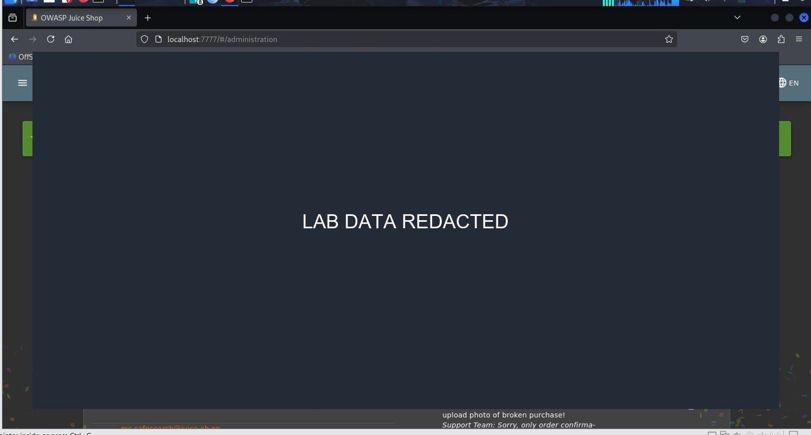

# Finding 4: Administrative access control

**Reported severity:** High
**Themes:** OWASP A01:2021 Broken Access Control; CWE-284

## Observation

The report found that an administrative view exposed user and feedback information after an administrator session had been obtained through a separate authentication flaw. This demonstrates the impact of privileged access, but depends on the upstream login compromise.

## Safe validation in the lab

In the local instance, compare anonymous and ordinary-user access to administrative views and APIs using synthetic accounts. Check the server response as well as page navigation; a hidden menu or frontend redirect does not prove backend enforcement.

## Impact

If administrative endpoints do not verify the caller's role, a stolen or forged session with insufficient privilege may expose data or actions. Authorization must be checked for every resource and operation.

## Remediation

- Verify identity and role server-side for every administrative request.
- Deny by default and check authorization at the resource/action level.
- Test direct API requests as anonymous, ordinary, and authorized users.
- Minimize returned data and log sensitive administrative actions.
- Treat frontend route guards as user-experience features only.

**References:** [OWASP Authorization Cheat Sheet](https://cheatsheetseries.owasp.org/cheatsheets/Authorization_Cheat_Sheet.html) ? [CWE-284](https://cwe.mitre.org/data/definitions/284.html)

## Report figures

*Figure 23. Administrative view; user and feedback data redacted.*
