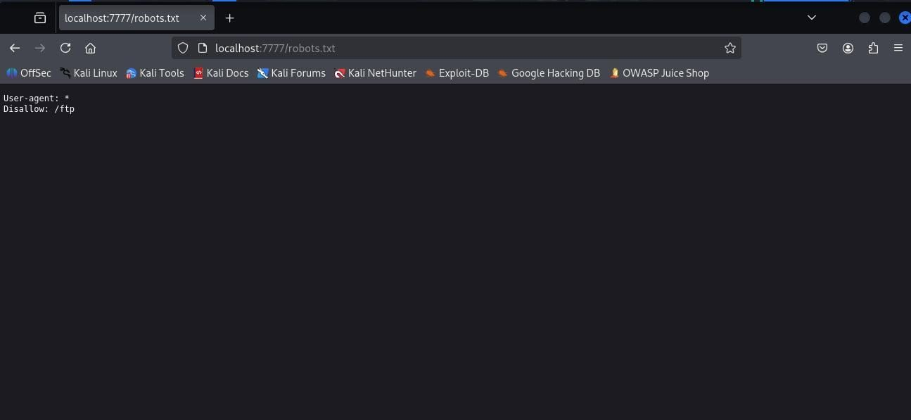
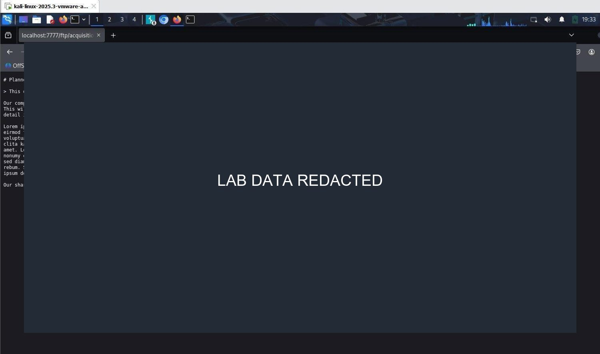
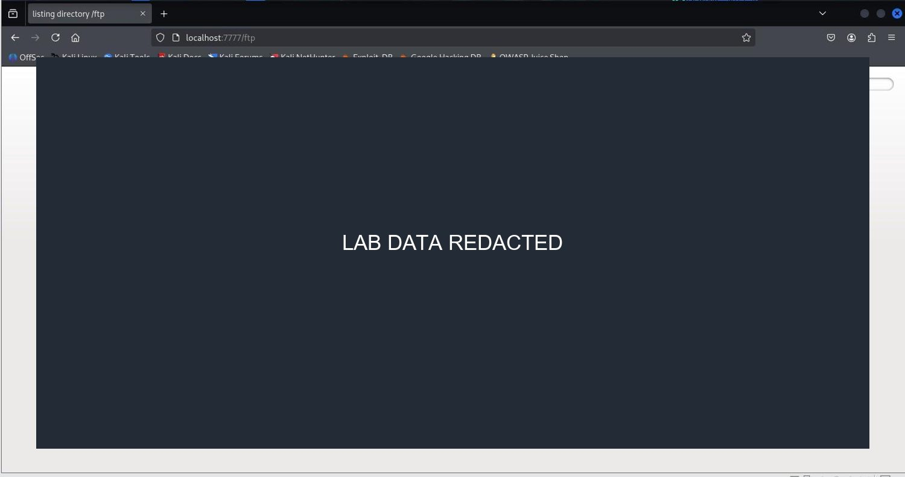
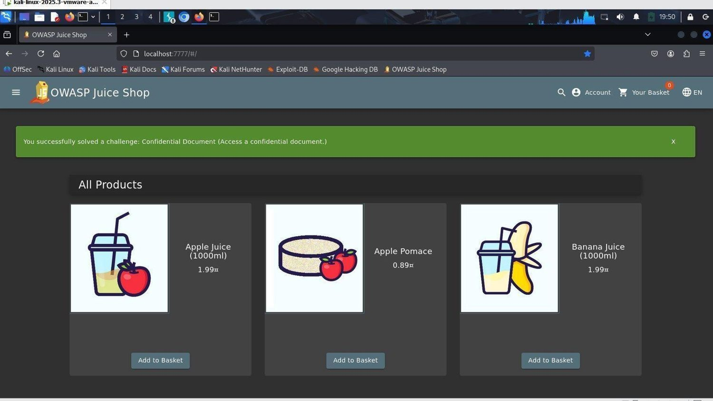

# Finding 6: Public file directory exposure

**Reported severity:** High
**Themes:** OWASP A05:2021 Security Misconfiguration; CWE-548

## Observation

The report describes an unauthenticated web-accessible file directory with directory listing enabled. It contained backup and business-document artifacts, including a credential-store file. Filenames and contents are not reproduced here.

## Safe validation in the lab

Visit the static-file area in your local Juice Shop and determine whether a directory index or unintended file is visible. Do not download, open, crack, or publish credential stores or private documents; the listing and file category are sufficient evidence.

## Impact

Public backups and documents can reveal source/configuration details or sensitive information. A credential database can create risk beyond the application if users reused passwords, but raw credentials should never be copied into a report.

## Remediation

- Disable directory indexing and restrict access to sensitive static content.
- Store backups, credential stores, and configuration outside the web root.
- Allowlist files intended for publication; deny backup extensions and hidden files.
- Audit static serving rules and add authorization checks to deployment tests.
- If real credentials were exposed, rotate them and assess reuse promptly.

**References:** [CWE-548](https://cwe.mitre.org/data/definitions/548.html) ? [OWASP Web Security Testing Guide](https://owasp.org/www-project-web-security-testing-guide/)

## Report figures

*Figure 25. Robots file path discovery for the lab.*

*Figure 26. Public file listing; file details redacted.*

*Figure 27. Confidential document view; contents redacted.*

*Figure 28. Local challenge completion for document access.*
