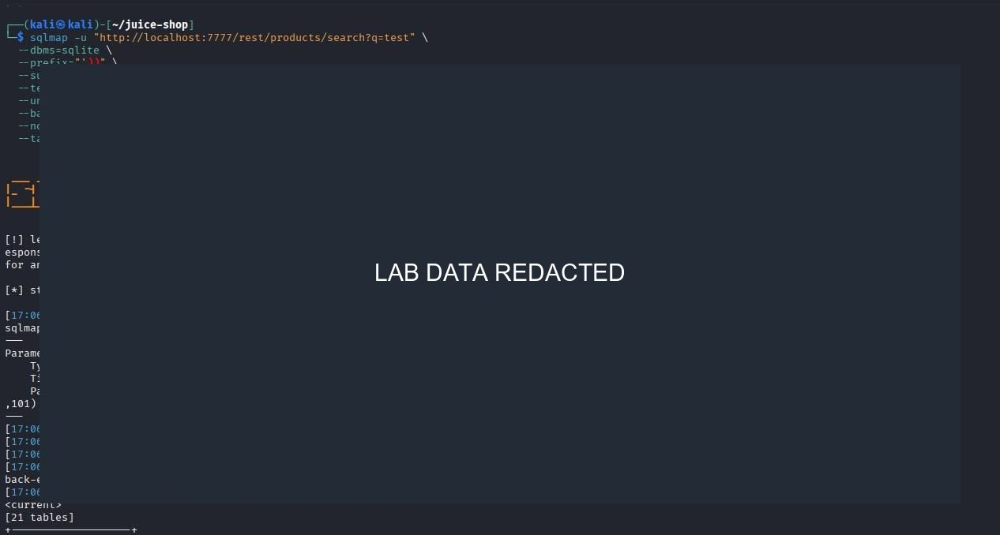
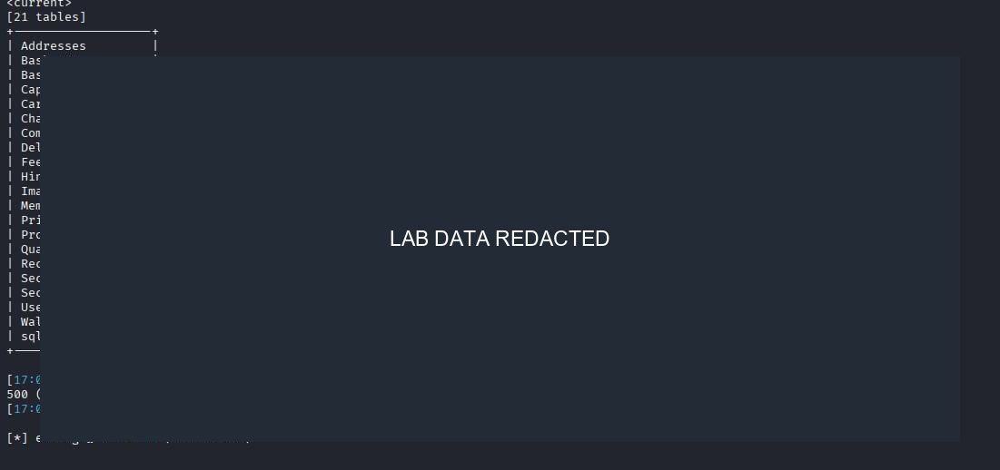
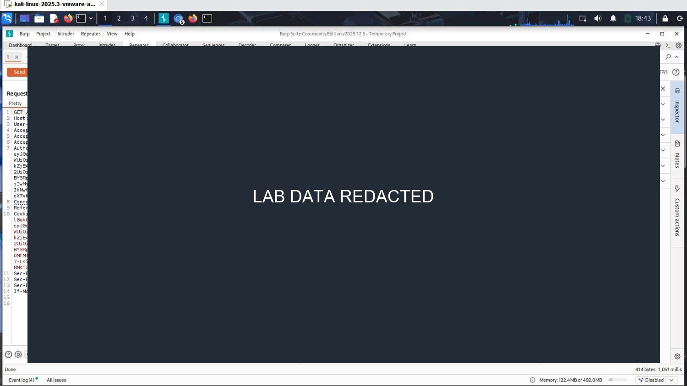
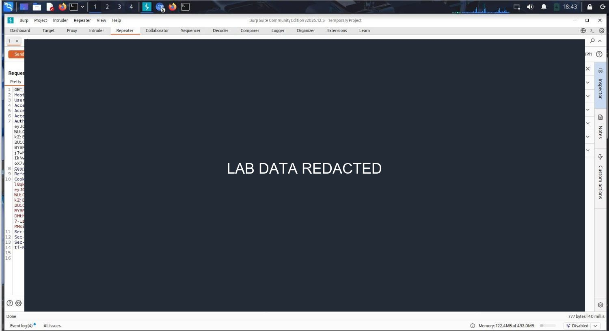
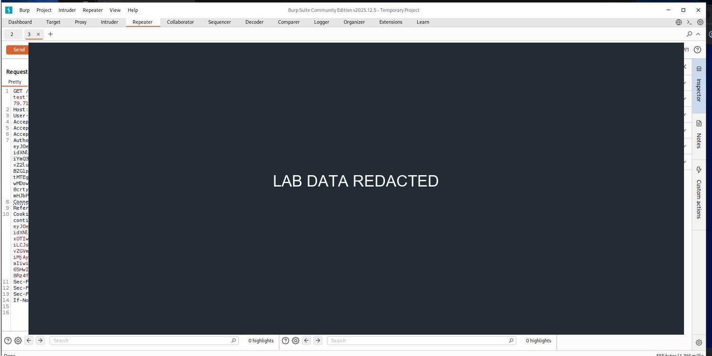
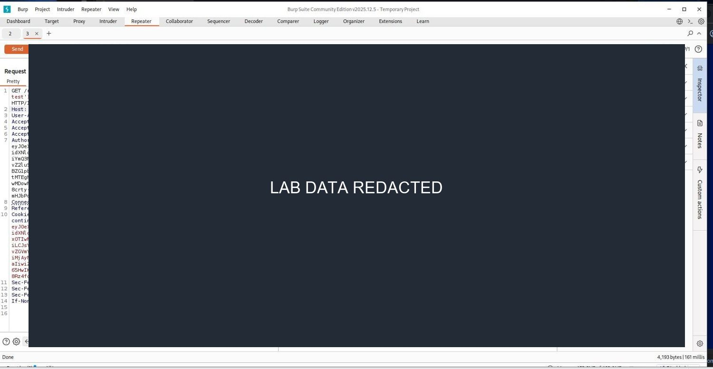
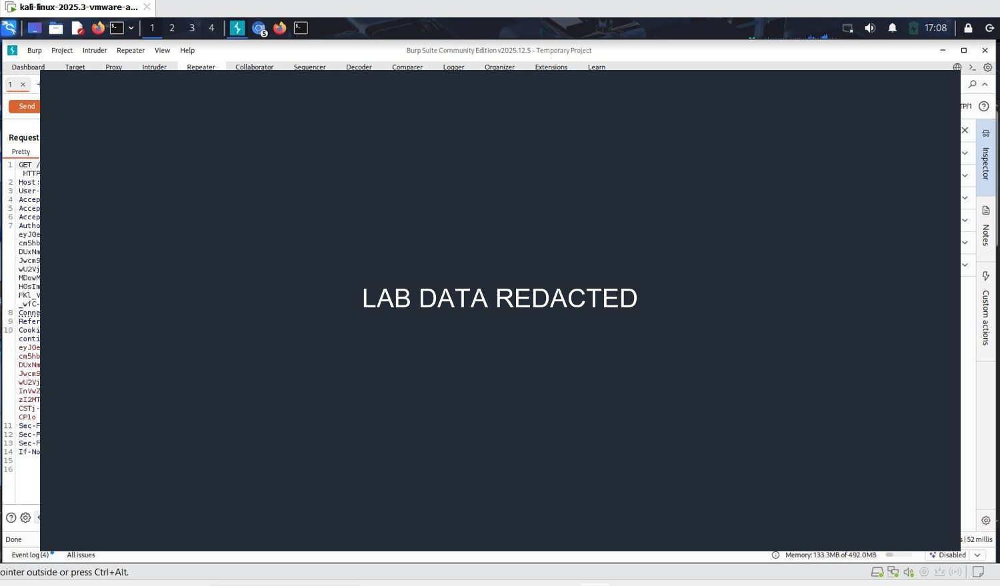
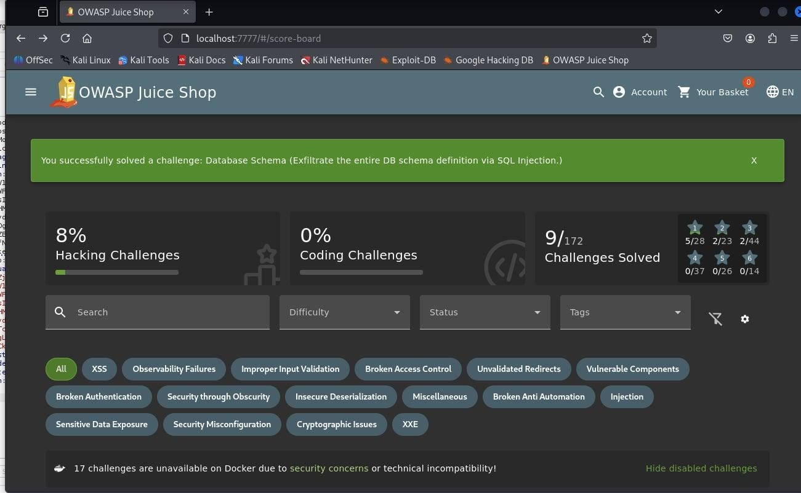

# Finding 10: SQL injection in product search

**Reported severity:** Critical
**Themes:** OWASP A03:2021 Injection; CWE-89

## Observation

The report describes unsafe handling of the product-search query parameter. Testing reportedly inferred database structure and accessed records. This guide omits extraction payloads, schemas, account data, hashes, and commands for dumping the database.

## Safe validation in the lab

Use the relevant Juice Shop challenge in the isolated local container. A benign malformed search value or the application's own challenge feedback is sufficient to establish unsafe input handling. Do not enumerate tables, export records, or run automated exploitation outside the local lab.

## Impact

SQL injection may permit unauthorized reading or modification of records, depending on query construction and database privileges. Potential personal or payment-related data makes evidence minimization essential.

## Remediation

- Use parameterized database queries for search filters and all other user-controlled queries.
- Allowlist expected input types and lengths as a supplementary check.
- Run the application with a least-privilege database identity.
- Avoid returning database errors or internal details to clients.
- Add regression tests proving input cannot alter query structure.

**References:** [OWASP SQL Injection Prevention Cheat Sheet](https://cheatsheetseries.owasp.org/cheatsheets/SQL_Injection_Prevention_Cheat_Sheet.html) ? [CWE-89](https://cwe.mitre.org/data/definitions/89.html)

## Report figures

*Figure 35. Local SQL-injection test command; command details redacted.*

*Figure 36. Database enumeration output redacted.*

*Figure 37. Database query test details redacted.*

*Figure 38. Database error comparison details redacted.*

*Figure 39. Database extraction request redacted.*

*Figure 40. User data and hash output redacted.*

*Figure 41. Database schema output redacted.*

*Figure 42. Local challenge completion for the schema exercise.*
