# Report figures

The 48 numbered figures are available below and embedded with their related report sections. The source report PDF is not included. Screenshots showing account identifiers, tokens, hashes, database contents, credentials, or phishing destinations have been redacted. Figure 11 is an illustrative replacement: the source PDF captioned it but contained no corresponding embedded image.

## Figure 01

*Docker image pull and container startup.*

## Figure 02

*Local Docker port mapping for Juice Shop.*

## Figure 03

*Browser proxy extension installed for the lab.*

## Figure 04

*Browser permission prompt during proxy setup.*

## Figure 05

*Proxy configuration using a loopback listener.*

## Figure 06

*Proxy selected for the lab browser.*

## Figure 07

*Local intercepting proxy listener settings.*

## Figure 08

*Proxy welcome page on the local machine.*

## Figure 09

*Second check of the local proxy listener.*

## Figure 10

*Browser trust prompt for the proxy certificate.*

## Figure 11

*Certificate manager import control; illustrative replacement because the PDF captioned this figure but had no embedded image.*

## Figure 12

*Proxy history showing lab traffic; request details redacted.*

## Figure 13

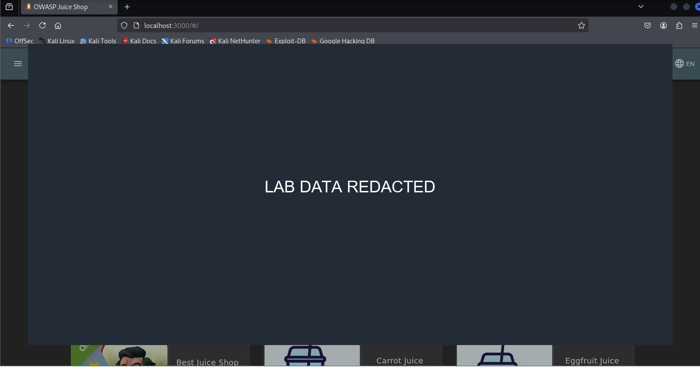

*Public product review with account identifier redacted.*

## Figure 14

*Application JavaScript bundle route discovery.*

## Figure 15

*Search within the JavaScript bundle for route names.*

## Figure 16

*Unauthenticated request to the administrative route.*

## Figure 17

*Juice Shop score board page.*

## Figure 18

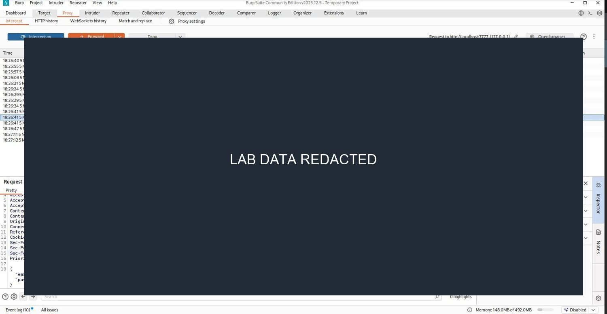

*Captured login request; account and request values redacted.*

## Figure 19

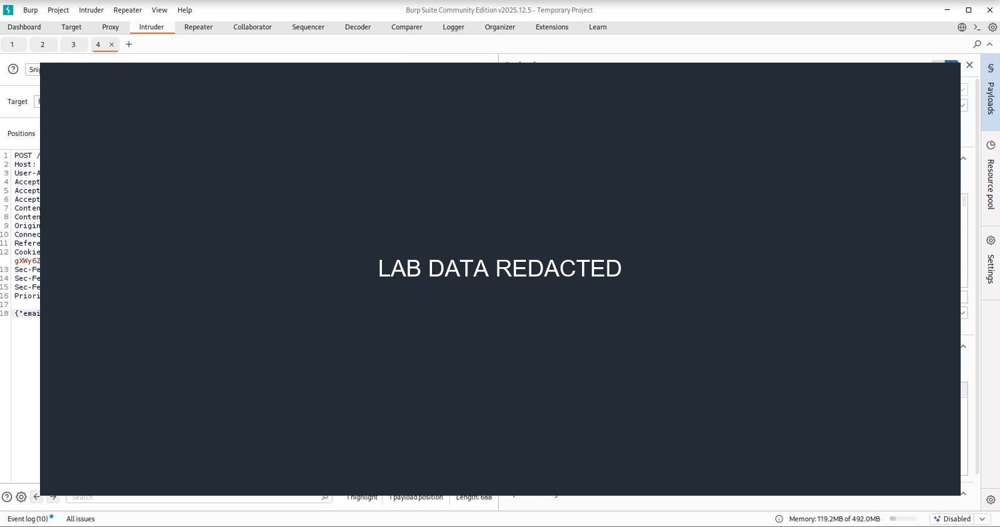

*Proxy Intruder configuration; payload details redacted.*

## Figure 20

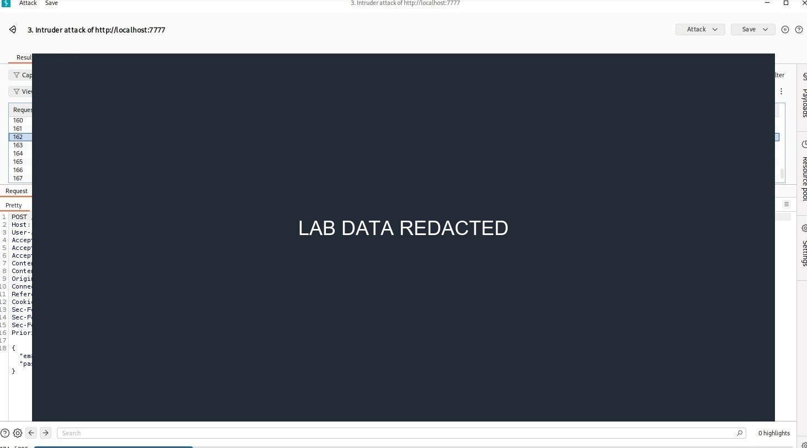

*Local login test results; response data redacted.*

## Figure 21

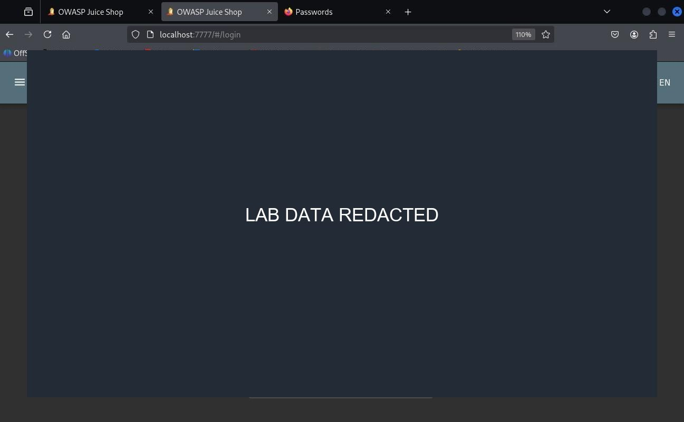

*Login form during local SQL-injection challenge; input redacted.*

## Figure 22

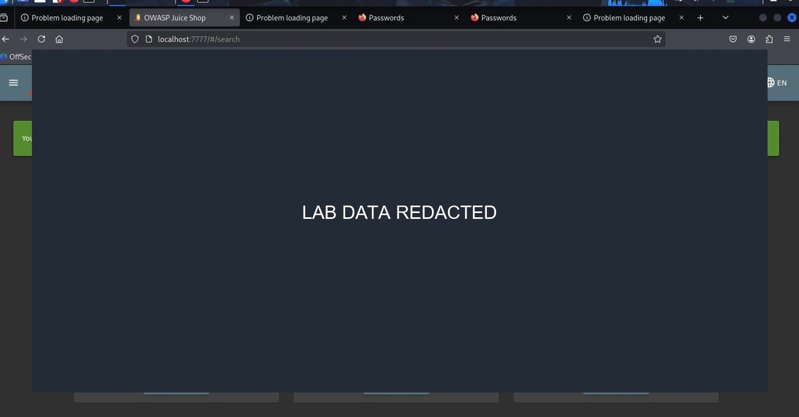

*Local challenge completion notification.*

## Figure 23

*Administrative view; user and feedback data redacted.*

## Figure 24

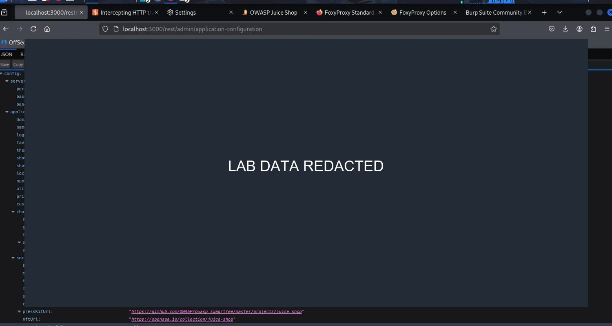

*Configuration API response; values redacted.*

## Figure 25

*Robots file path discovery for the lab.*

## Figure 26

*Public file listing; file details redacted.*

## Figure 27

*Confidential document view; contents redacted.*

## Figure 28

*Local challenge completion for document access.*

## Figure 29

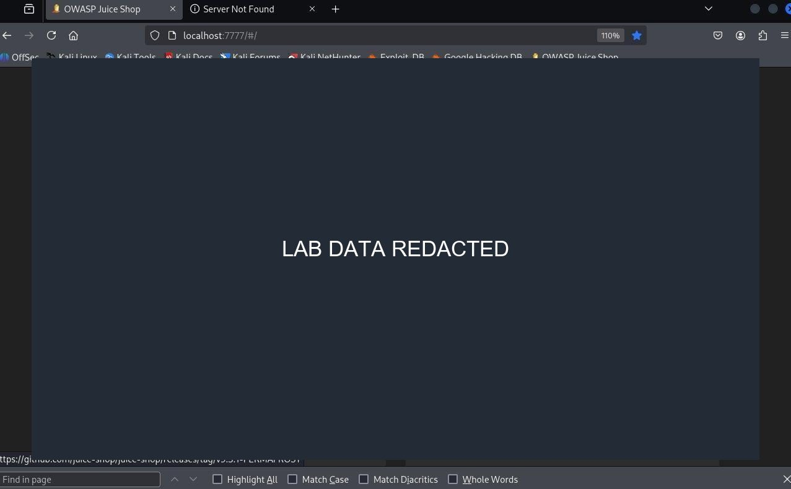

*Public review with account identifier redacted.*

## Figure 30

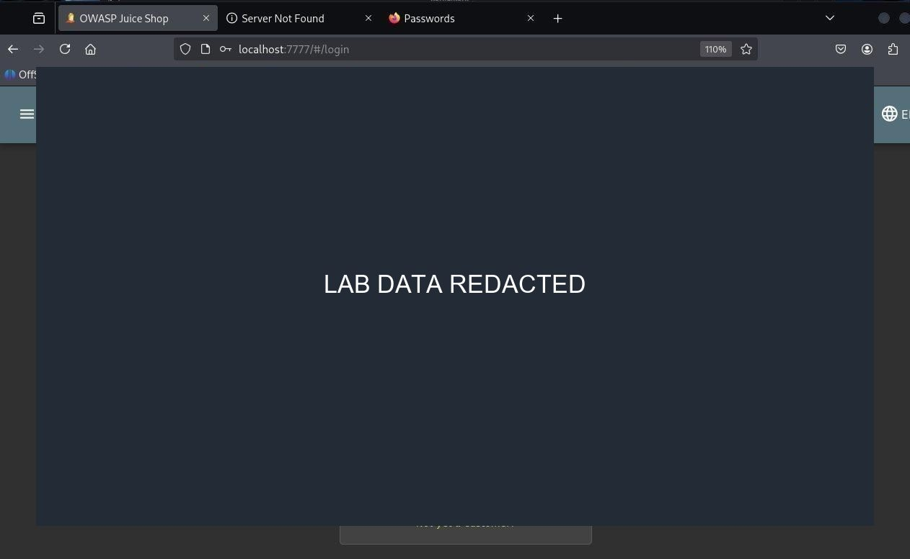

*Login form during local account challenge; input redacted.*

## Figure 31

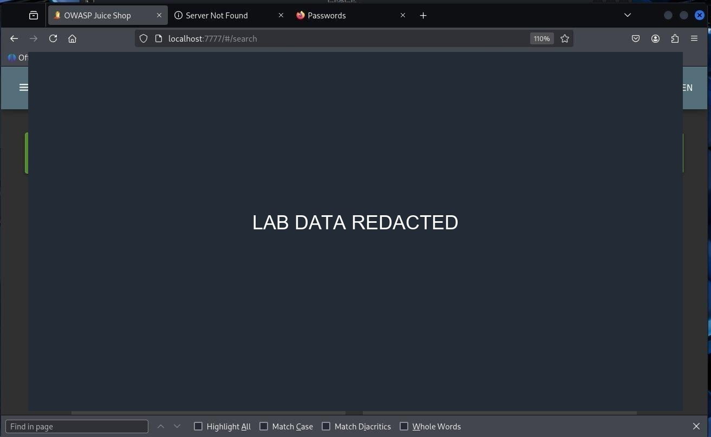

*Local challenge completion notification.*

## Figure 32

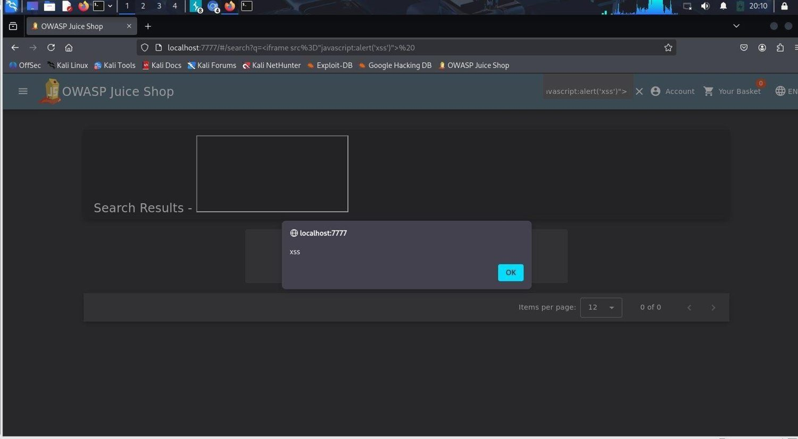

*Harmless DOM-XSS challenge marker in the lab.*

## Figure 33

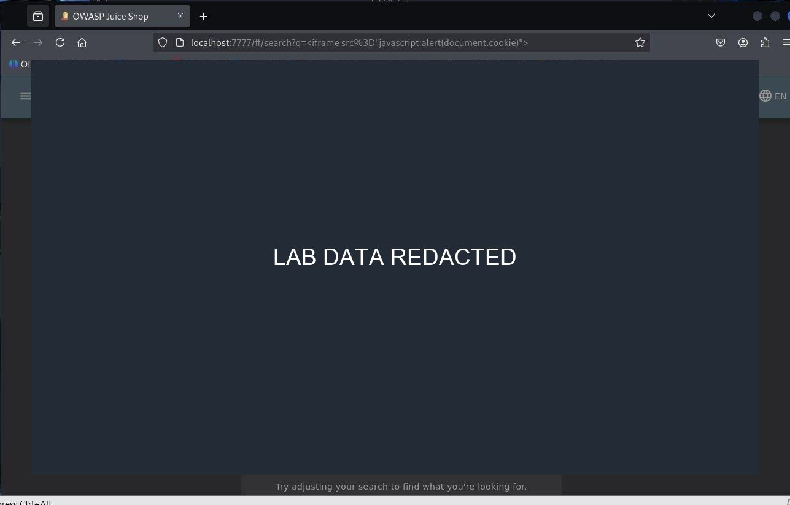

*Session-token display redacted.*

## Figure 34

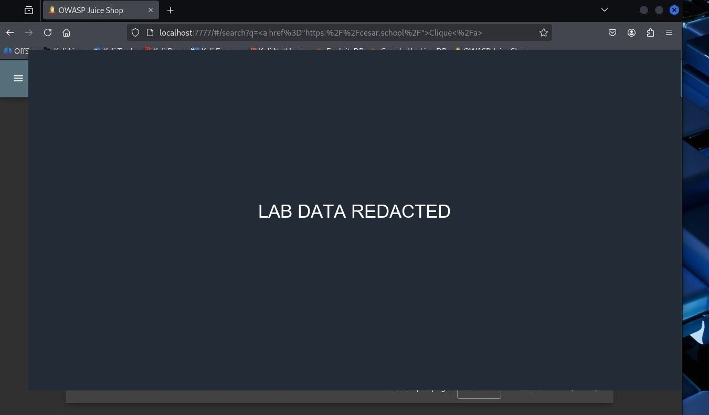

*Reflected HTML demonstration redacted.*

## Figure 35

*Local SQL-injection test command; command details redacted.*

## Figure 36

*Database enumeration output redacted.*

## Figure 37

*Database query test details redacted.*

## Figure 38

*Database error comparison details redacted.*

## Figure 39

*Database extraction request redacted.*

## Figure 40

*User data and hash output redacted.*

## Figure 41

*Database schema output redacted.*

## Figure 42

*Local challenge completion for the schema exercise.*

## Figure 43

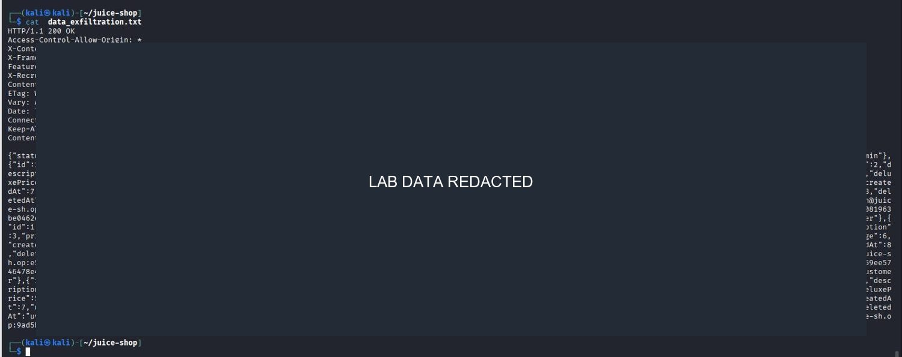

*Exported records redacted.*

## Figure 44

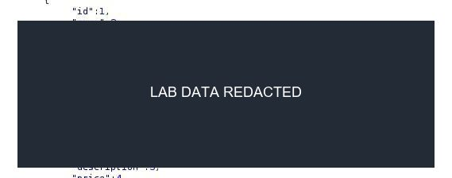

*Password hash value redacted.*

## Figure 45

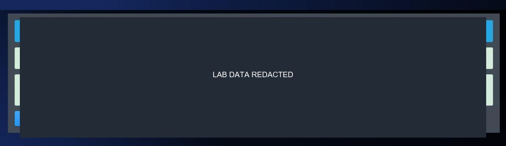

*Hash identification result redacted.*

## Figure 46

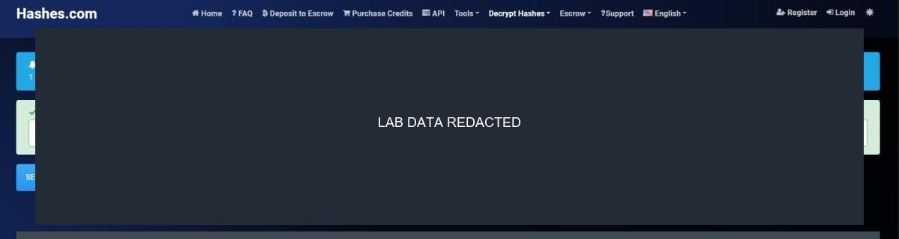

*Recovered password output redacted.*

## Figure 47

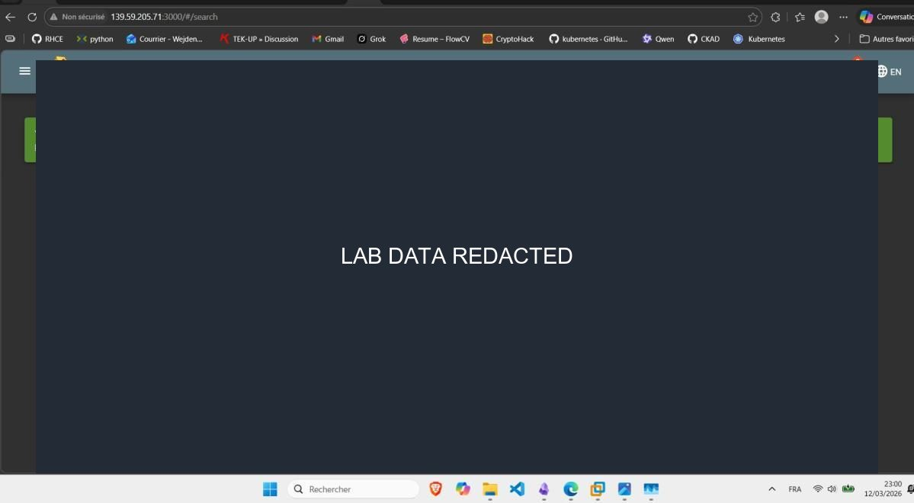

*Credential lookup challenge evidence redacted.*

## Figure 48

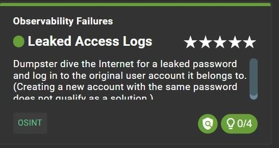

*Local score-board challenge card.*
